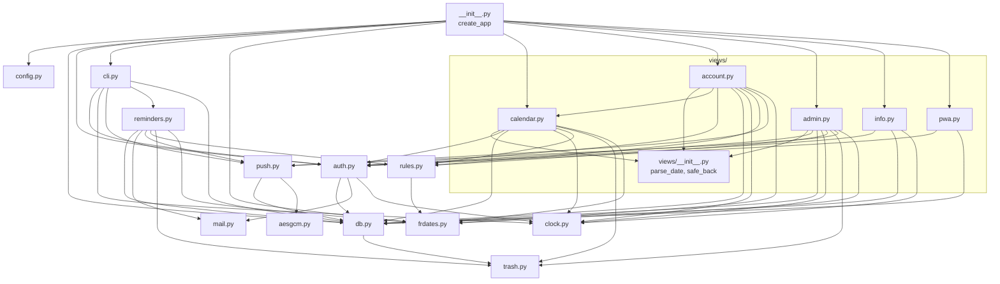

# Architecture

GCCopro is a server-rendered Flask app (Python 3.12, SQLite, Waitress) for a building's chores rota:
residents book whole weeks, and the person on duty is notified the evening before each trash pickup.
This document describes how the code is organised and which file depends on which.
See [CLAUDE.md](CLAUDE.md) for commands, conventions and NAS constraints.

## Repository layout

```
gccpro/                  repo root
├── gccpro/              the Python package (the app)
│   ├── __init__.py      app factory: create_app()
│   ├── config.py        defaults + TOML file + test overrides
│   ├── db.py            SQLite connection, migrations, query helpers
│   ├── schema/          NNN_*.sql migrations (applied at startup)
│   ├── auth.py          login tokens, session, CSRF, rate limit, decorators
│   ├── mail.py          send_mail (SMTP, console or in-memory)
│   ├── clock.py         today() / utcnow() in Europe/Paris
│   ├── rules.py         booking rules (pure)
│   ├── trash.py         trash pickup expansion (pure)
│   ├── frdates.py       French date formatting (pure)
│   ├── phones.py        phone normalisation (E.164), display, wa.me links (pure)
│   ├── push.py          Web Push: RFC 8291 encryption + VAPID
│   ├── aesgcm.py        pure-Python AES-GCM used by push.py
│   ├── reminders.py     daily reminder job
│   ├── cli.py           `flask` sub-commands
│   ├── views/           Flask blueprints (HTTP layer)
│   ├── templates/       Jinja2 pages (all extend base.html)
│   └── static/          style.css, sw.js, app.js, icons
├── tests/               pytest suite
├── deploy/              NAS shell scripts + config.example.toml
├── requirements*.txt
└── pytest.ini
```

## Layers

The code is layered. A module only imports from layers below it, so there are no import cycles.

| Layer | Modules | Role |
|-------|---------|------|
| Entry points | `__init__.py` (`create_app`), `cli.py`, `deploy/*.sh` | Build the app, expose CLI commands, run it in production |
| HTTP | `views/*` + `templates/` + `static/` | Parse requests, call logic, render French pages |
| Services | `auth.py`, `reminders.py`, `push.py`, `mail.py` | Side-effecting features (login, notifications, email) |
| Pure logic | `rules.py`, `trash.py`, `frdates.py`, `aesgcm.py` | No Flask, no DB, no clock: trivially unit-testable |
| Infrastructure | `config.py`, `db.py`, `clock.py`, `schema/` | Configuration, persistence, time |

## Module dependency graph

Arrows read "imports". External libraries are left out (see the Dependencies section).



Things worth noticing:

- **Leaves** (import nothing from the package): `frdates`, `trash`, `aesgcm`, `mail`, `clock`, `config`, `views/__init__`.
- **`db.py`** is the hub. It is imported by almost everything, and imports only `trash` (to build `Rule` / `Exception_` objects in `trash_config()`).
- **`views/account.py` imports `views/calendar.py`** (`build_month`) to reuse the month grid on "my weeks".
- **`cli.py` and `reminders.py`** are not imported by views. They can run with no HTTP request, only an app context.
- Nothing imports `__init__.py` except the entry points and tests, so `create_app` is the single wiring point.

## Responsibilities in detail

### Entry points
- **[gccpro/\_\_init\_\_.py](gccpro/__init__.py)**: `create_app(test_config)` loads config, then runs `db.init_app`, `auth.init_app` and `cli.init_app`. It registers the five blueprints and the French date template filters, adds security headers (strict CSP, no inline scripts or styles) and renders 400/403/404 as `error.html`.
- **[gccpro/cli.py](gccpro/cli.py)**: `create-admin`, `login-link`, `gen-vapid`, `send-reminders`, `backup`. It delegates to `auth`, `push`, `reminders` and `db`.

### Infrastructure
- **[config.py](gccpro/config.py)**: three layers, in order: defaults, the TOML file named by `GCCPRO_CONFIG`, then overrides passed to `create_app`. Keys are Flask config keys.
- **[db.py](gccpro/db.py)**: per-request connection (`get_db`, closed on teardown). `migrate` applies each `schema/NNN_*.sql` once at startup. Also holds `get_setting` / `set_setting`, `bookings_between`, `booking_owners`, `trash_config` and `get_resident`.
- **[clock.py](gccpro/clock.py)**: `today()` returns the Europe/Paris date, overridable with the `TODAY` config in tests. Never call `date.today()`.
- **schema/001_init.sql**: tables `residents`, `login_tokens`, `bookings` (primary key `week_start`, the Monday), `trash_rules`, `trash_exceptions`, `push_subscriptions`, `announcements`, `notification_log`, `settings`.

### Pure logic
- **[rules.py](gccpro/rules.py)**: `validate_booking` (1 or 2 consecutive weeks, max 2 in a row, horizon), `cancel_deadline` / `can_cancel`, `reminder_recipient` (owner of the week containing the day *before* the pickup) and `free_weeks_to_announce`.
- **[trash.py](gccpro/trash.py)**: `Rule`, `Exception_`, `Pickup` dataclasses. `pickups()` expands weekly / even / odd ISO-week rules, with cancel and move exceptions, into dates.
- **[frdates.py](gccpro/frdates.py)**: French day and month names without locale, exposed as Jinja filters.
- **[aesgcm.py](gccpro/aesgcm.py)**: AES-GCM encryption in pure Python, because `cryptography` has no wheel for the NAS.

### Services
- **[auth.py](gccpro/auth.py)**:
  - One-time login links: only a SHA-256 hash of the token is stored in `login_tokens`.
  - GET on the link only shows a button; POST consumes it, which protects against mail scanners.
  - Signed cookie session, per-email/IP `RateLimiter`, CSRF check on every POST.
  - `login_required` and `admin_required` decorators, and `init_app` which registers the before-request hooks.
- **[mail.py](gccpro/mail.py)**: `send_mail` with backends chosen by config: SMTP in production, console in dev, an in-memory list in tests.
- **[push.py](gccpro/push.py)**: VAPID signing (`ecdsa`), RFC 8291 payload encryption (HKDF + `aesgcm`), `deliver` to one subscription and `send_to_resident`, which reads `push_subscriptions`.
- **[reminders.py](gccpro/reminders.py)**: `run(today, dry_run)` computes pickups (`trash`), finds the recipient (`rules.reminder_recipient`) and sends push, falling back to email. `notification_log` makes it idempotent.

### HTTP layer (`views/`)

| Blueprint | Routes | Notes |
|-----------|--------|-------|
| `calendar.py` | `GET /`, `POST /reserver` | Month grid, `week_infos`, `build_month`, booking |
| `account.py` | `/connexion`, `/connexion/<token>` (GET and POST), `POST /deconnexion`, `GET /mes-semaines`, `POST /annuler` | Login flow, my weeks, cancel |
| `info.py` | `GET /infos` | Announcements and the AG date |
| `admin.py` | `GET /admin` and POST actions (residents, week assignment, trash rules and exceptions, announcements, settings, test notification) | Every route wrapped in `admin_required` |
| `pwa.py` | `/sw.js`, `/manifest.webmanifest`, `POST /push/abonnement`, `POST /push/desabonnement` | Service worker and push subscription |

`views/__init__.py` provides the shared helpers `parse_date` and `safe_back` (a safe redirect target).
A view should only load data through `db.py` helpers, call the pure modules, then render a template or redirect.

### Frontend
- **templates/**: every page extends `base.html`. `_month.html` is a partial for the month grid. `admin/index.html` is the admin page.
- **static/**: `style.css`, `sw.js` (service worker, served at `/sw.js` by `pwa.py`), `app.js` (push subscribe button, which calls `/push/abonnement`) and the icons. No build step.

## Request flows

**Booking a week**
`POST /reserver` → `_check_csrf` (auth) → `login_required` → `calendar.book` → `rules.validate_booking` using `db.bookings_between` → insert into `bookings` → flash and redirect.

**Login**
`/connexion` → `auth.allow_login_request` → `auth.send_login_link` → `mail.send_mail`.
The user then opens the link (`GET /connexion/<token>`, button only). `POST /connexion/<token>` calls `auth.consume_login_token` and `auth.log_in`, which sets the session cookie.

**Daily reminder** (DSM task at 18:00 → `deploy/reminders.sh` → `flask send-reminders`)
`cli.send_reminders` → `reminders.run` → `db.trash_config` + `db.booking_owners` → `trash.pickups` → `rules.reminder_recipient` → `push.send_to_resident` (or `mail.send_mail` if there is no subscription) → `notification_log`.

## Runtime dependencies

From [requirements.txt](requirements.txt). All must be pure Python (NAS: 32-bit ARMv7).

| Package | Used for |
|---------|----------|
| `flask` (+ Jinja2) | Web framework and templates |
| `waitress` | Production WSGI server (single process) |
| `ecdsa` | VAPID ES256 signing and ECDH for Web Push |
| `certifi` | CA bundle for outbound TLS |
| `tzdata` | IANA time zone data for `zoneinfo` (Europe/Paris) |

Dev only ([requirements-dev.txt](requirements-dev.txt)): `pytest`, and `cryptography`, used by the tests to cross-check `aesgcm.py`.

## Tests

| File | Covers |
|------|--------|
| `conftest.py` | `app` fixture: temp DB, in-memory mail, fresh VAPID key, fixed `TODAY` (Wed 2026-10-21) |
| `test_rules.py` | `rules.py` |
| `test_trash_and_dates.py` | `trash.py`, `frdates.py` |
| `test_push_crypto.py` | `aesgcm.py` and `push.py` against RFC and NIST vectors |
| `test_reminders.py` | `reminders.py` (idempotency, push/email fallback) |
| `test_views.py` | End-to-end through the Flask test client |

## Deployment

```
PC: deploy/deploy.sh ──tar over ssh──▶ NAS: app/
                                         └─ deploy/install.sh: update venv, restart

NAS layout   /volume1/homes/claude/gccpro/
             ├── app/    code, replaced on each deploy
             ├── venv/   Python 3.12 virtualenv
             └── data/   config.toml (chmod 600), gccpro.db, backups/, logs/
```

All the shell scripts source `deploy/env.sh` for shared paths.

- Waitress listens on `127.0.0.1:8090`, behind the DSM reverse proxy (HTTPS).
- DSM Task Scheduler, as user `claude`:
  - `start.sh`: at boot and every 5 minutes (watchdog).
  - `reminders.sh`: daily at 18:00.
  - `backup.sh`: nightly.
- Admin helpers: `login-link.sh` and `set-smtp-password.sh`.
- The schema is migrated automatically on app start, so deploys need no separate migration step.

## Conventions to keep

- Business rules go in the pure modules and get unit tests. Views stay thin.
- New schema changes are new numbered files in `schema/`. Never edit an applied one, and avoid `STRICT` tables.
- Use `clock.today()` for time, never `date.today()`.
- Every POST needs the CSRF token (`csrf_token` form field or `X-CSRF-Token` header).
- No inline scripts or styles in templates (CSP).
- User-facing text is French. Code, comments and logs are English.
